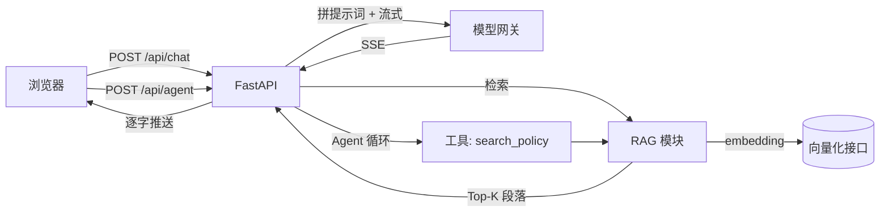

# 企业制度问答助手（Policy Agent）

一个可以直接跑起来的最小可用 AI Agent 项目：**RAG 检索 + 工具调用 + 流式输出 + 多模型切换**。

面向「把大模型接进业务系统」这类场景，用一个虚构公司的制度文档做示例数据，演示从检索、拼接上下文、流式返回到 Agent 工具循环的完整链路。

## 功能

- **知识库问答（RAG）**：把 `data/` 下的文档切块、向量化，提问时按语义相似度检索，把最相关的段落塞进提示词，回答附出处。
- **Agent 模式**：把「查制度」注册成一个工具，由模型自己决定是否调用、用什么关键词调用，并展示完整执行轨迹。
- **流式输出（SSE）**：回答逐字返回，首字延迟低，体验接近主流聊天产品。
- **多模型切换**：前端下拉框切换模型，后端由统一网关转发，业务代码不感知供应商差异。
- **多轮记忆**：保留最近 10 条对话，控制长上下文成本。
- **密钥隔离**：所有密钥走环境变量，仓库里不出现任何 `sk-` 开头的字符串。

## 架构



## 快速开始

```bash
# 1. 安装依赖（建议使用虚拟环境）
pip install -r requirements.txt

# 2. 配置密钥：复制模板，填入自己的 Key
#    Windows:  copy .env.example .env
#    macOS/Linux:  cp .env.example .env

# 3. 启动（在项目根目录执行）
python -m app.main
```

浏览器打开 <http://127.0.0.1:8000>。

> 也可以用 `uvicorn app.main:app --reload` 启动，改代码自动生效。

### 配置项（.env）

| 变量 | 说明 | 默认值 |
|---|---|---|
| `DASHSCOPE_API_KEY` | 模型平台密钥，必填 | 无 |
| `LLM_BASE_URL` | OpenAI 兼容的接口地址 | 阿里云百炼 |
| `LLM_MODEL` | 默认模型 | `deepseek-v4.1-flash` |
| `LLM_MODELS` | 下拉框可选模型，逗号分隔 | `deepseek-v4.1-flash,qwen-turbo,qwen-plus` |
| `EMBED_MODEL` | 向量化模型 | `text-embedding-v3` |

换平台时只改 `LLM_BASE_URL` 和模型名，业务代码一行不用动。

## 项目结构

```
policy-agent/
├── app/
│   ├── config.py     # 配置与密钥读取
│   ├── llm.py        # 模型网关：流式 / 非流式 / 向量化
│   ├── rag.py        # 切块、向量化、余弦检索
│   ├── agent.py      # 工具定义与 Agent 循环
│   └── main.py       # FastAPI 路由与 SSE
├── data/             # 知识库文档（txt）
├── web/index.html    # 单页前端
├── requirements.txt
└── .env.example
```

## 接口

| 方法 | 路径 | 说明 |
|---|---|---|
| GET | `/` | 前端页面 |
| GET | `/api/config` | 可选模型列表 |
| GET | `/api/health` | 健康检查 |
| POST | `/api/chat` | 流式对话，`{q, model, history, use_kb}` |
| POST | `/api/agent` | Agent 模式，返回 `{answer, steps, sources}` |

`/api/chat` 返回的 SSE 事件有三种：`status`（状态提示）、`sources`（引用来源）、`delta`（正文片段），以 `data: [DONE]` 结束。

## 几个设计取舍

**为什么自己算余弦，而不用向量数据库？**
几十段文本的场景，内存里算一遍比引入 Chroma 更快也更透明。文档规模上千段后，换成 pgvector 或 Chroma，`search()` 的实现替换即可，接口不变。

**为什么模型网关单独一层？**
模型供应商的地址、参数、报错格式都不一样。把差异收敛在 `llm.py`，上层只处理「消息进、文字出」，换模型或加降级逻辑都不影响业务代码。

**为什么 Agent 用非流式、对话用流式？**
Agent 需要先拿到完整的 `tool_calls` 才能执行工具，流式反而增加复杂度。真实产品通常「工具阶段不流式，最终回答流式」，本项目为了清晰做了简化。

## 已知限制

- 文档切块按空行切分，长段落会超长，生产环境应换成递归切分并控制块大小。
- 检索没有重排序，表述差异较大时可能召不回正确段落。
- 会话历史保存在浏览器内存，刷新即丢失，也不支持多用户隔离。
- 没有做限流与配额统计。

## 后续计划

- [ ] 接入真正的向量库（Chroma / pgvector）
- [ ] 检索结果加入重排序
- [ ] 增加流式输出的中断与重试
- [ ] 加入请求日志与 Token 用量统计
- [ ] 多模型自动降级

## 技术栈

Python 3.10+ · FastAPI · Uvicorn · requests · SSE · OpenAI 兼容接口
